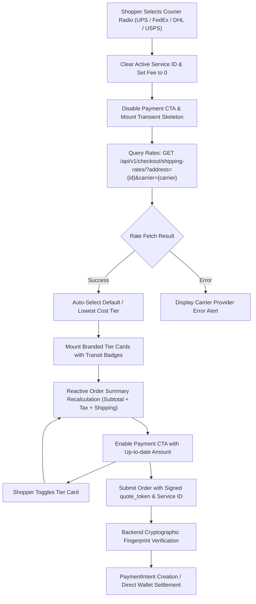
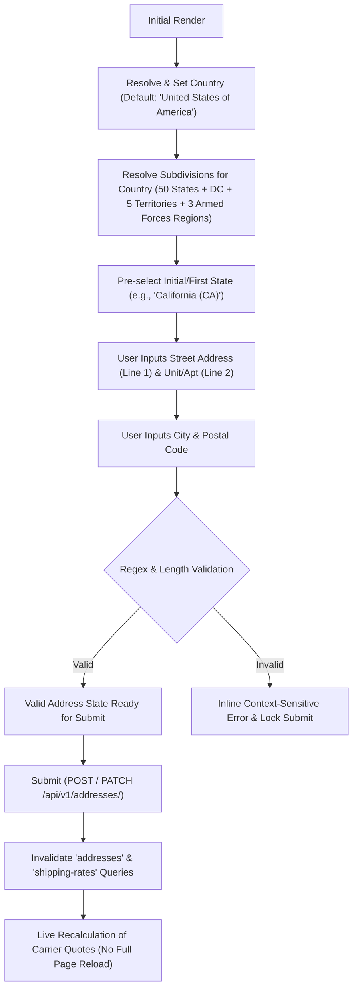

# Multi-carrier checkout and dynamic service tiers

USPS, UPS, FedEx, and DHL Express use direct backend rating adapters in `server/payment/carriers.py`. Requests have an eight-second transport timeout. Live errors return a validation error; they never fall back to invented live rates. Carrier credentials remain server-side.

USPS Web Tools was retired January 25, 2026. The checkout adapter uses OAuth and the current Prices v3 API. See [USPS retirement notice](https://www.usps.com/business/web-tools-apis/documentation-updates.htm), [USPS API examples](https://github.com/USPS/api-examples), [UPS official rating schema](https://github.com/UPS-API/api-documentation/blob/main/Rating.yaml), [FedEx Rates and Transit Times](https://developer.fedex.com/api/en-us/catalog/rate/v1/docs.html), and [DHL MyDHL API](https://developer.dhl.com/api-reference/dhl-express-mydhl-api).

## Carrier Plan Dictionary

| Carrier | Service Code | Service ID | Frontend Display Title | Transit Estimate | Normalized Badge Tag |
| --- | --- | --- | --- | --- | --- |
| **UPS** | `03` | `ups_03` | UPS Ground | Est. 3–5 business days | `Economical` |
| **UPS** | `02` | `ups_02` | UPS 2nd Day Air | Est. 2 business days | `Standard` |
| **UPS** | `01` | `ups_01` | UPS Next Day Air | Next business day by 10:30 AM / 12:00 PM | `Fastest` |
| **DHL** | `ECONOMY_SELECT` / `H` | `dhl_economy_select` | DHL Economy Select | Est. 2–5 business days | `Economical` |
| **DHL** | `EXPRESS_1200` / `T` | `dhl_express_1200` | DHL Express 12:00 | Next business day by 12:00 PM | `Standard` |
| **DHL** | `EXPRESS_WORLDWIDE` / `D` / `P` | `dhl_express_worldwide` | DHL Express Worldwide | Est. 1–3 business days | `Fastest` |
| **FedEx** | `FEDEX_GROUND` | `fedex_fedex_ground` | FedEx Ground | Est. 1–5 business days | `Economical` |
| **FedEx** | `FEDEX_2_DAY` | `fedex_fedex_2_day` | FedEx 2Day | Est. 2 business days | `Standard` |
| **FedEx** | `PRIORITY_OVERNIGHT` | `fedex_priority_overnight` | FedEx Priority Overnight | Next business day morning delivery | `Fastest` |
| **USPS** | `ground_advantage` | `usps_ground_advantage` | USPS Ground Advantage | Est. 2–5 business days | `Best Value` |
| **USPS** | `priority_mail` | `usps_priority_mail` | USPS Priority Mail | Est. 1–3 business days | `Standard` |
| **USPS** | `priority_express` | `usps_priority_express` | USPS Priority Mail Express | Overnight to 2-day guaranteed | `Fastest` |

## Checkout State Machine Architecture



## Configuration

| Variable | Purpose |
| --- | --- |
| `SHIPPING_RATE_MODE` | `live` or explicit development `demo`; defaults to live outside Django debug mode |
| `SHIPPING_SANDBOX` | `true` selects carrier test environments; `false` selects production |
| `USPS_CLIENT_ID`, `USPS_CLIENT_SECRET` | USPS OAuth application credentials |
| `UPS_CLIENT_ID`, `UPS_CLIENT_SECRET`, `UPS_ACCOUNT_NUMBER` | UPS OAuth credentials and shipper account |
| `FEDEX_CLIENT_ID`, `FEDEX_CLIENT_SECRET`, `FEDEX_ACCOUNT_NUMBER` | FedEx OAuth credentials and shipping account |
| `DHL_API_KEY`, `DHL_API_SECRET`, `DHL_ACCOUNT_NUMBER` | MyDHL Basic authentication and shipper account |
| `SHIPPING_PACKAGE_LENGTH_IN`, `SHIPPING_PACKAGE_WIDTH_IN`, `SHIPPING_PACKAGE_HEIGHT_IN` | Consolidated parcel dimensions; defaults 10 × 8 × 4 inches |
| `CHECKOUT_TAX_RATE` | Tax fraction on merchandise after coupon discount; default `0`, e.g. `0.07` |
| `FREE_SHIPPING_THRESHOLD` | Existing platform threshold; cheapest eligible service becomes free |
| `STRIPE_SECRET`, `STRIPE_CURRENCY`, `STRIPE_WALLET_PAYMENT_METHODS` | Existing payment configuration; shipping rates require USD |

Create sandbox applications in each carrier portal, enable rating scopes/products, and obtain account-specific credentials. There are no universal sandbox credentials to copy into this project. Set `SHIPPING_SANDBOX=true` and `SHIPPING_RATE_MODE=live` to exercise real sandbox requests. Set `SHIPPING_RATE_MODE=demo` only for deliberate development fixtures; rate responses and checkout display explicitly mark them as development rates. Empty production credentials make the selected carrier unavailable.

Test bases are `https://apis-tem.usps.com`, `https://wwwcie.ups.com`, `https://apis-sandbox.fedex.com`, and `https://express.api.dhl.com/mydhlapi/test`. Production bases are `https://apis.usps.com`, `https://onlinetools.ups.com`, `https://apis.fedex.com`, and `https://express.api.dhl.com/mydhlapi`.

## API and payment binding

Only customer/seller JWTs may call checkout endpoints; admin/staff tokens receive `403`.

1. `GET /api/v1/checkout/shipping-rates/?address={owned_address_id}&carrier=UPS` returns available service plans. Carrier values are `USPS`, `UPS`, `FEDEX`, or `DHL`.
2. Each plan includes `carrier`, `service_id`, `name`, `description`, decimal-string `amount`, `currency`, `source`, `is_default`, `tax`, `shipments`, and `quote_token`. Digital delivery has zero shipping and no physical shipment list.
3. Selecting a plan updates the client total immediately. The selected `shipping_service` and `shipping_quote` are submitted with `address`, `checkout_key`, and optional `coupon` to direct checkout or Stripe wallet-session creation.

Example:

```json
{"address":7,"checkout_key":"a65c6e46-c10e-4bd8-aaca-a4fcff4776e1","shipping_service":"ups_03","shipping_quote":"signed token from the rates response","payment_type":"user_wallet"}
```

A quote references a server-side immutable rate record and is bound to user, cart ID, product price/weight/quantity, and full destination address. Quotes expire after 15 minutes before payment. Changed carts, addresses, service IDs, expired tokens, and invalid service choices fail validation. Direct legacy clients omitting the quote still receive a freshly validated carrier rate; client-supplied shipping amounts are never trusted.

Stripe Checkout and its PaymentIntent retain the carrier, service, quote token, address, coupon, and checkout reference in metadata. Confirmation reuses the persisted quote rather than re-fetching a changing carrier price. Paid confirmation allows up to seven days and compares the paid amount to the final cart total before order creation. If the cart or pricing changes after payment, confirmation fails and requires operational review. Delivery charges are stored with decimal cents rather than rounded down to whole currency units. Orders preserve `shipping_snapshot` (also returned as `shipping` by customer order APIs), `carrier`, `tax`, subtotal, and total. Store order fulfillment accepts all four carriers and produces official tracking links.

## Fulfillment boundaries

Physical deliveries retain the existing US-only service area; digital products remain available worldwide. Parcels are consolidated by pickup ZIP, summing physical weights. For different origin ZIPs, quotes sum shipment charges and expose only services offered for every origin. Every store must supply a complete default business address, including digital-only sellers. Physical shipping quotes use that address and fail clearly when it is missing; there is no fallback pickup ZIP. Configure parcel dimensions to match the fulfillment operation; product-specific packing and international customs are outside this implementation.

Tax uses the configured fixed fraction, not an external jurisdictional tax engine. Quote tax is shown before coupon entry; the server applies coupon discounts before computing final tax. Cart estimates are development estimates until a delivery address and carrier are selected.

The rating APIs are synchronous and need no carrier webhook registration. This change does not implement carrier label purchasing or carrier scan webhooks. Fulfillment staff record milestones through the existing store tracking endpoint; customers receive those milestones and official carrier tracking links. Retired USPS XML endpoints are no longer called, and synthetic scan events are not presented as live carrier data. Existing Stripe confirmation still validates payment through Stripe; no new payment webhook URL is introduced.

## Validation and maintenance

Run backend tests with test settings (explicit demo rates), frontend type checking, and unit tests. Adapter parsing uses mocked official response shapes; provisioned sandbox and live carrier accounts are required for end-to-end carrier verification.

Shipping quote records contain fulfillment metadata and address fingerprints, not carrier credentials. Retain paid order snapshots; expired unreferenced quote rows may be removed by an operator according to the deployment retention policy.

## Testing & QA Verification Matrix

| Area | Verification Scenario | Expected Outcome |
| --- | --- | --- |
| **Rapid Courier Toggling** | User clicks between UPS, FedEx, DHL, and USPS rapidly. | Previous service plans immediately unmount; transient loading skeleton displays; previous quote token is purged; lowest-cost plan auto-preselects upon query resolution; payment button stays disabled during flight. |
| **Service Tier Badges & Normalization** | Display of all 4 carrier active tiers. | Each carrier displays its designated tiers with branded naming, accurate transit windows (e.g., "Next business day by 10:30 AM"), and normalized badges (`Fastest`, `Best Value`, `Standard`, `Economical`). |
| **Reactive Order Summary** | Switching between tiers within a carrier or toggling carrier. | Cart summary lines (`Delivery (Carrier)`, `Tax`, `Total to pay`) recalculate instantly to `item_subtotal + tax + selected_shipping_rate` without page reload. |
| **Network Failure & Fallbacks** | Carrier API times out (> 8s) or returns 5xx error. | Provider error message is surfaced to user (`form-error`); never falls back to invented rates; payment CTA remains safely disabled. |
| **Responsive Stacking** | Viewport widths 360px, 430px, 768px, 1024px, 1440px. | Carrier radio options grid stacks into 2 columns on mobile without label overflow or clipped inputs; tier cards retain legible padding and right-aligned rates; no horizontal document scroll leaks. |
| **Payload Integrity** | Form checkout submission via Stripe or Store Credit Wallet. | Payload contains validated `address`, `checkout_key`, `shipping_service`, and signed `shipping_quote` token matching the selected tier; backend verifies cryptographic HMAC fingerprint. |

## Geographic Address Selector & Dynamic Postal Validation

### 1. Address Schema & Form Control State Machine

The address entry form (`AddressForm` in `client/src/components/account.tsx`, backed by `client/src/lib/geo.ts`) uses a deterministic hierarchical state machine across both Checkout and the Customer Account Address Book (`/account/addresses`):



- **Field Layout & Visual Hierarchy**:
  - **Desktop / Tablet (768px+)**:
    - **Row 1**: Country Selector (100% full width dropdown).
    - **Row 2**: Street Address (~65% width) + Apartment / Suite / Block / Unit (~35% width).
    - **Row 3**: City, State Dropdown, and Postal/ZIP Code in a balanced 3-column equal grid (`repeat(3, minmax(0, 1fr))`).
  - **Mobile Viewports (360px–430px)**: All 6 fields cleanly stack vertically into a 1-column layout (`minmax(0, 1fr)`) with minimum touch targets of 44px to prevent tap errors.
- **Parent-Child Hierarchical Relationship**: Selecting or resetting the country dispatches an event that immediately clears downstream subdivision choices and queries the dictionary for the target country's official subdivisions.
- **Categorization of Disabled Options**: The country selector uses accessible `<optgroup>` elements:
  - `Active Shipping Destinations`: Contains enabled, selectable countries (`United States of America`).
  - `International Destinations (Currently Unavailable)`: Contains all other ISO 3166-1 countries, explicitly marked with the `disabled` HTML attribute and styled with `cursor: not-allowed` and reduced opacity (`— Coming soon`).

### 2. Geographic Data Dictionaries

The centralized data dictionary is located in [`client/src/lib/geo.ts`](file:///Users/samad/Documents/GitHub/e-commerce-backend/client/src/lib/geo.ts):

- **ISO 3166-1 Alpha-2 Catalog**: Contains all major internationally recognized countries with standard English nomenclature and 2-letter codes.
- **US Subdivisions (59 Regions)**:
  - All 50 US States (AL, AK, AZ, AR, CA, CO, CT, DE, FL, GA, HI, ID, IL, IN, IA, KS, KY, LA, ME, MD, MA, MI, MN, MS, MO, MT, NE, NV, NH, NJ, NM, NY, NC, ND, OH, OK, OR, PA, RI, SC, SD, TN, TX, UT, VT, VA, WA, WV, WI, WY).
  - Federal District: District of Columbia (`DC`).
  - US Outlying Territories: American Samoa (`AS`), Guam (`GU`), Northern Mariana Islands (`MP`), Puerto Rico (`PR`), U.S. Virgin Islands (`VI`).
  - US Armed Forces Military Mail (APO/FPO/DPO): Armed Forces Americas (`AA`), Armed Forces Europe / Africa / Middle East (`AE`), Armed Forces Pacific (`AP`).
- **Territory Availability Restrictions**: In Phase 1, physical shipments are strictly restricted to the United States and its territories due to carrier rating contracts. International shipping will be enabled in subsequent releases by toggling `isSupported: true` in the catalog.

### 3. Granular Delivery Inputs & Carrier Payload Mapping

To maximize delivery success rates and conform directly with courier addressing standards, delivery location inputs are partitioned into primary street coordinates and secondary unit identifiers:

| UI Field Name | HTML / Autofill Spec | Validation Guardrail | Storage Model | Carrier Payload Mapping |
| --- | --- | --- | --- | --- |
| **Street Address** | `name="street"`<br>`autocomplete="address-line1"` | Required; minimum 5 characters; stripped of `<>` characters. | Persisted in `address` column as primary line. | • **UPS**: `AddressLine[0]`<br>• **FedEx**: `streetLines[0]`<br>• **DHL**: `postalAddress.addressLine1`<br>• **USPS**: `streetAddress` |
| **Apartment / Suite / Block / Unit** | `name="unit"`<br>`autocomplete="address-line2"` | Optional; maximum 30 characters; stripped of `<>` characters. | Combined into `address` column via `composeAddress(street, unit)`. | • **UPS**: `AddressLine[1]`<br>• **FedEx**: `streetLines[1]`<br>• **DHL**: `postalAddress.addressLine2`<br>• **USPS**: `secondaryAddress` |
| **City** | `name="city"`<br>`autocomplete="address-level2"` | Required; alphanumeric, spaces, hyphens, periods, apostrophes. | `city` column | `City` / `cityName` across all carriers |
| **State / Territory** | `name="state"`<br>`autocomplete="address-level1"` | Required dropdown; matches state code or name. | `state` column | `StateProvinceCode` / `provinceCode` |
| **Postal / ZIP Code** | `name="zip"`<br>`autocomplete="postal-code"` | Required regex match based on country. | `zip` column | `PostalCode` / `postalCode` across all carriers |

### 4. Postal Regex Lookup Table

| Country | ISO Code | Regex Pattern | Format Description | Example Values | Context-Sensitive Error Message |
| --- | --- | --- | --- | --- | --- |
| **United States** | `US` | `^\d{5}(-\d{4})?$` | 5-digit ZIP or ZIP+4 | `90210`, `90210-1234` | "Please enter a valid 5-digit US ZIP code or ZIP+4 (e.g. 90210 or 90210-1234)." |
| **United Kingdom** | `GB` | `^[A-Za-z]{1,2}\d[A-Za-z\d]?\s*\d[A-Za-z]{2}$` | Alphanumeric outward/inward | `SW1A 1AA`, `W1A 0AX` | "Please enter a valid UK postal code (e.g. SW1A 1AA)." |
| **Nigeria** | `NG` | `^\d{6}$` | 6-digit numeric | `102103`, `100001` | "Please enter a valid 6-digit Nigerian postal code (e.g. 102103)." |
| **Global Fallback** | `*` | `^[a-zA-Z0-9\s-]{3,10}$` | Standard alphanumeric | `1010`, `75001` | "Please enter a valid postal code (3–10 alphanumeric characters)." |

### 5. Testing & QA Verification Matrix

| Test Scenario | Verification Condition | Expected Result | Automated Test Reference |
| --- | --- | --- | --- |
| **Pre-selected US Default** | Mount `AddressForm` with empty initial data. | Country defaults to `"United States of America"` (`US`); state options populate with 59 US states/territories/military regions; postal placeholder displays `"90210 or 90210-1234"`. | `client/tests/unit/geo.test.mjs` |
| **Non-selectable Country States** | User opens country dropdown. | All international countries display with `disabled` attribute and `"Coming soon"` badge; browser prevents selection of disabled options. | `client/tests/unit/geo.test.mjs` |
| **Granular Street & Unit Entry** | User enters Street `"742 Evergreen Terrace"` and Unit `"Apt 4B"`. | Form validates successfully; composes into `"742 Evergreen Terrace, Apt 4B"` for storage; `parseAddressLines` cleanly recovers both segments when editing. | `client/tests/unit/geo.test.mjs` |
| **Unit Field Length & Sanitization** | User enters unit with HTML tags or exceeding 30 characters. | Special `<>` characters stripped; strings > 30 characters produce error `"Apartment / Block number must be 30 characters or fewer"`. | `client/tests/unit/geo.test.mjs` |
| **Dynamic US State Population** | Inspect State/Province dropdown options. | Exactly 59 entries rendered (50 states + DC + 5 territories + AA, AE, AP); each formatted as `"Name (Code)"`; clean state name bound on submit. | `client/tests/unit/geo.test.mjs` |
| **Invalid US Postal Rejection** | User enters `"9021"`, `"902100"`, `"90210-12"`, or `"ABCDE"`. | Inline red error displays: `"Please enter a valid 5-digit US ZIP code or ZIP+4 (e.g. 90210 or 90210-1234)"`; form submission is blocked. | `client/tests/unit/geo.test.mjs` |
| **Valid US Postal Acceptance** | User enters `"90210"` or `"90210-1234"`. | Error clears; form submits cleanly to `POST /api/v1/addresses/` or `PATCH /api/v1/addresses/<id>/`. | `client/tests/unit/geo.test.mjs` |
| **Downstream Rate Recalculation** | Address saved in checkout or address book. | TanStack Query cache keys `['addresses']` and `['shipping-rates']` are invalidated; shipping rates refresh automatically for destination ZIP. | `server/storefront/tests.py` |
| **Responsive Desktop Layout (768px+)** | Viewport width >= 768px. | Row 1: Country (full width); Row 2: Street Address (~65%) and Unit (~35%); Row 3: City, State, ZIP in 3-column equal grid. | `client/src/app/globals.css` |
| **Responsive Mobile Layout (360px–430px)** | Viewport resized to 375px mobile viewport. | Country, Street, Unit, City, State, and Postal code stack into a 1-column layout (`grid-template-columns: minmax(0, 1fr)`) with min touch target height 44px; zero horizontal overflow. | `client/src/app/globals.css` |


Store onboarding requires a complete business address (street, city, state/region, country and postal code). Products may be saved as drafts, but manual and scheduled publication require that address for both digital and physical listings.

Purchase validation also rejects existing stores without a complete default business address, including digital-only stores. Missing physical shipment origins return a validation error rather than silently using Tampa.

Time handling: Django stores timezone-aware UTC instants (`TIME_ZONE=UTC`, `USE_TZ=True`). Browser date/time inputs display local time and submit ISO UTC timestamps. Dashboard requests accept a validated IANA `time_zone` (UTC by default); the browser supplies its timezone for local calendar-day reporting. Date-only chart labels are preserved without timezone shifts. Cron and carrier request clocks use aware UTC; flash countdowns include minutes.

Military postal delivery: APO/FPO/DPO destinations use USPS only with the currently supported integrations. Checkout disables other carrier options and the server rejects unsupported carriers in both demo and live rating and payment flows. Address city/state/ZIP must agree: AA uses 340xx, AE uses 090xx–098xx, AP uses 962xx–966xx, with country United States. This is a supported-service policy, not a claim that all commercial postal handoff services are prohibited: UPS Ground Saver and Mail Innovations have military-address support but are not integrated here. See [USPS military addressing standards](https://pe.usps.com/text/dmm300/703.htm) and [UPS supported services](https://www.ups.com/us/en/support/shipping-support/print-shipping-labels/how-to-write-address). ZIP blocks alone do not guarantee an active destination or eligibility for every USPS service; live carrier availability and military mail content/customs requirements still apply.
